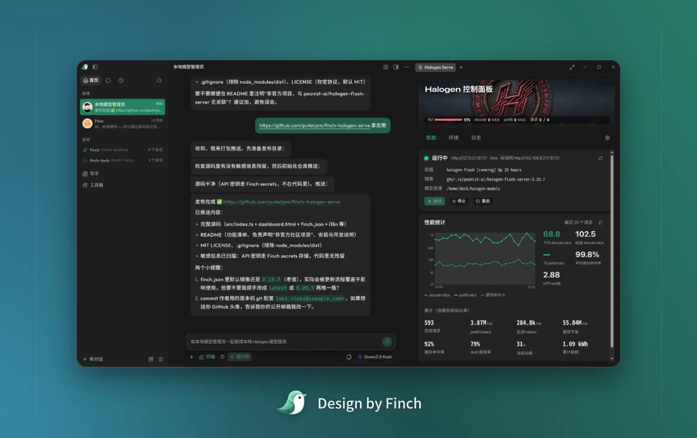

# finch-halogen-serve



A [Finch](https://finch) mini tool (mini program) that manages a local
[Halogen](https://github.com/peonist-ai/halogen-flash-server) model inference
server running in a **podman** container — start / stop / restart, live logs,
health and environment checks, performance statistics, and image updates, all
from a dashboard panel inside Finch.

> **Disclaimer**: this is an unofficial community project. It is not affiliated
> with, endorsed by, or maintained by the peonist-ai team. Halogen and
> halogen-flash-server are trademarks of their respective authors.

## Features

- **Service control** — start / stop / restart the managed container; the
  first start creates it with your saved settings.
- **Dashboard panel** (Finch app panel + composer quick menu):
  - Status tab: container state, API latency, model info, live metrics bar
    (KV pool usage, decode/prefill tok/s, active requests) refreshed every 3 s.
  - Environment tab: podman, image, models dir, GPU devices (`/dev/kfd`,
    `/dev/dri`), memory requirement check, API port probe, and image-update
    detection.
  - Logs tab: real-time `podman logs -f` streaming with clear.
  - Settings tab: friendly switches that map to `HALOGEN_*` environment
    variables — vision tower, 8-bit KV cache, KV pool size, KV slots, cache
    entries/branches, API key (stored via Finch secrets), host port, LAN
    binding, and a read-only stats API endpoint for other machines.
- **Performance statistics** — parses per-request summaries from the container
  log: decode / prefill speed curves (hover for per-request detail), prompt
  cache hit rate, KV pool usage, GPU power (amdgpu PPT sensor) and estimated
  accumulated energy.
- **Image updates** — checks GHCR for newer tags, with a GitHub tags-API
  fallback because the GHCR `tags/list` index is known to lag; shows pull
  progress (per-blob bytes and speed, parsed from podman output), supports
  cancel, and survives panel close/reopen. After a successful update it can
  recreate the container on the new image and clean up old tags.
- **Stats API** (optional, LAN-friendly) — read-only JSON endpoints
  (`/live`, `/stats`, `/status`) on a separate port so other machines or
  dashboards can poll the same numbers the panel shows.

## Requirements

- Finch desktop app
- podman (v4+; tested with 6.x)
- A machine that can run `halogen-flash-server` (see the upstream docs for
  GPU / memory requirements)

## Download

Grab the latest `.fapp` installer from the
[Releases page](https://github.com/puterjam/finch-halogen-serve/releases) —
download `finch-halogen-serve-vX.Y.Z.fapp`, then **double-click it** (with
Finch installed) or **drag it into the Finch window** to install. The tool
installs disabled on purpose: open Toolcase, review the permissions and enable
it.

## Install

From source:

```bash
git clone https://github.com/puterjam/finch-halogen-serve.git
cd finch-halogen-serve
npm install
npm run build
npx @finchtoys/minitools add .
```

Then restart Finch (or reload mini tools). A ⚡ entry appears in the composer
menu and the app panel launcher.

## Configuration

The tool reads these Finch settings (defaults shown):

| Key | Default | Meaning |
|---|---|---|
| `port` | `8731` | Host API port |
| `image` | `ghcr.io/peonist-ai/halogen-flash-server:0.18.7` | Image to run; the update flow overrides and persists a newer tag automatically |
| `modelsDir` | `/home/deck/halogen-models` | Host models directory mounted read-write into `/models` |
| `containerName` | `halogen-flash` | Managed container name |

Adjust them in Finch's mini-tool settings, or just use the dashboard's
⚙ settings tab (options are stored per-tool and applied when the container is
recreated).

## Development

```bash
npm install
npm run build      # tsc + copy panel assets to dist/
```

Edit `src/index.ts` (backend + agent tool) and `src/dashboard.html` (panel).
While iterating, use Finch's mini-tool reload to pick up a new `dist/`.

## License

MIT
